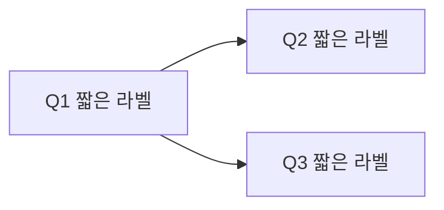

# Tail Cards — 꼬리질문 카드 생성 스킬

학생의 전공 노트를 **면접관이 실제로 파고드는 순서의 꼬리질문 체인**으로 재구성한다. 각 카드는 질문(인출 단서)과 답의 판단 근거("왜 이렇게 답하나")를 함께 남긴다.
CS-Tutor의 `card-interview` 스킬을 과목·폴더 구조와 무관하게 일반화한 버전이다.

## 1. 입력 확인
- 대상: 사용자가 지정한 노트 파일(.md/.txt) 또는 붙여넣은 텍스트. 지정이 없으면 어떤 노트로 만들지 묻는다.
- 과목·단원 제목: 파일명/첫 헤딩에서 추정하고, 애매할 때만 묻는다.
- 말투 샘플: 사용자가 쓴 면접 답변 문단이 있으면 "풀어 말하기" 문체를 그에 맞춘다.

## 2. 노트 유형 판단 및 (필요 시) 개념 노트 정리
노트가 이미 정리 노트면 그대로 근거로 쓴다. **교재 원문·거친 메모**라면 먼저 `<단원> concept.md`를 노트 옆에 만들고(기존 파일은 덮어쓰지 않음) 그것을 근거로 쓴다.
- A. 7단계형(자료구조·시스템 구성요소처럼 "이전 방식의 한계 → 새 구조"로 발전): `## 배경 / ## 정의 / ## 구현 / ## 이렇게 구현하는 이유 / ## 활용 / ## 장점 / ## 단점·한계`
- B. 방법론형(알고리즘·증명 중심): `## 문제 설정 / ## 핵심 아이디어(불변식) / ## 정당성(직관) / ## 복잡도 / ## 비교·선택 기준 / ## 경계 조건`
- 지엽적 일화·단순 손계산 예제 제외, 끝에 `## 예상 꼬리질문`(?로 끝나는 질문 3~6개).

## 3. 질문 설계
- 순서는 노트 순서가 아니라 **면접관이 파고드는 순서**: 오프닝(정의) → "왜?" → "그럼 이 경우엔?" → 비교 → 한계/다음 개념.
- 7단계형: 배경 "왜 필요한가요?", 정의 "~이 무엇인지 설명해 주세요", 구현 "어떻게 동작하나요?", 이유 "왜 A가 아니라 B인가요?", 활용 "어디에 쓰이나요?", 장단점 "~와 비교해 주세요 / 항상 보장되나요?", 한계 "그러면 ~한 경우엔?"
- 방법론형: 문제 설정, 핵심 아이디어/불변식, 정당성(왜 항상 맞나), 복잡도와 이유, A 대신 B를 쓰는 상황, 경계 조건.
- **카드 1장 = 질문 1개 = 30초 답변.** 길어지면 쪼개서 꼬리질문으로 넘긴다. 보통 5~15장, 소주제 섹션 2~4개.
- 노트의 `예상 꼬리질문`, `?`로 끝나는 메모는 우선 카드화. 노트에 답이 없는 질문은 `✍️ 직접 채울 카드`로 보낸다.
- 노트 범위를 넘는 고급 개념은 카드로 만들지 않고 `꼬리 →`에 `(→ 다음 단원)` 브릿지만 남긴다. 증명은 직관 1~2문장까지.

## 4. 카드 뒷면 규칙
| 항목 | 규칙 |
|---|---|
| **두괄식** | 1문장, 결론부터. 핵심어는 **굵게** |
| **키워드** | 3개 내외, `` `백틱` `` 으로 감싸고 ` / `로 구분. 연습 때 "이 말이 들어갔나" 체크 기준 (앱이 자동 판정에 사용) |
| **풀어 말하기** | 30초 분량(2~4문장) 구어체 (`~구요`, `~는데요`, `~습니다`) |
| **왜 이렇게 답하나** | **절대 비우지 않음.** ① 이 답이 어떤 꼬리질문(Qn)을 유도하는지 ② 왜 이 순서·표현·반례를 골랐는지 + 다음 줄에 `>   → [[노트파일명#헤딩]]` 근거 링크 |
| **함정** | 말하면 안 되는 표현·흔한 오해 (없으면 줄 생략) |
| **꼬리 →** | `[[#^<prefix>-qNN|QN]]` 링크를 쉼표로. 없으면 `—` |

- 노트에 없어 일반 지식으로 보충한 카드는 근거 줄을 `>   → 📌 [[노트#헤딩]] (노트 미정리)`로 쓰고, 파일 끝 `## 📌 노트 보강 후보`에 모은다.
- 숫자·복잡도·용어는 노트와 일치시킨다.

## 5. 출력 파일 형식 (반드시 이 형식 — 앱 파서가 읽는다)
파일명: `<단원 제목> (카드형).md`, 위치: 노트와 같은 폴더(사용자가 지정하면 그곳). 같은 이름 파일이 있으면 덮어쓰기 전에 묻는다.
`<prefix>`는 단원을 나타내는 짧은 영문 소문자(예: `hash`, `sched`).

````markdown
### source
**concept** : [[<노트 파일명(확장자 제외)>]]

> [!info] 카드 ID: `^<prefix>-qNN`

---

## 0. 흐름 한 줄

```
<개념> → <구현> → <핵심 메커니즘> → <문제/한계> → <해결책> → <다음 개념>
```



---

## 1. <섹션명>

### Q1. <면접관 질문>
> [!answer]- 뒷면
> - **두괄식**: ...
> - **키워드**: `...` / `...` / `...`
> - **풀어 말하기**: ...
> - **왜 이렇게 답하나**: ...
>   → [[<노트 파일명>#<헤딩>]]
> - **함정**: ...
> - **꼬리 →** [[#^<prefix>-q02|Q2]], [[#^<prefix>-q03|Q3]]

^<prefix>-q01

---

## ✍️ 직접 채울 카드

### Q?. <노트에 답이 없는 질문>
> [!answer]- 뒷면 (직접 작성)
> - **두괄식**: 
> - **키워드**: 
> - **왜 이렇게 답하나**: 
> - **힌트 (지울 것)**: <연결해 볼 카드 번호 / 근거 링크>

---

## 📌 노트 보강 후보
- Q?: <빠진 내용 한 줄>
````

형식 체크리스트(저장 전 스스로 확인):
- 카드 헤딩은 정확히 `### Q<숫자>. 질문` (직접 채울 카드는 `### Q?.`)
- 뒷면은 `> [!answer]- 뒷면` 다음 줄부터 `> - **필드명**: 값` 한 줄씩 (꼬리는 `> - **꼬리 →** ...`처럼 콜론 없음)
- 각 카드 뒤 빈 줄 하나 + `^<prefix>-qNN` 블록 ID (두 자리 번호)
- mermaid의 화살표 = 각 카드의 `꼬리 →` 링크와 일치
- 블록 ID는 파일 안에서 유일

## 6. 보고
완료 후 채팅에는 생성 파일 경로, 카드 수(직접 채울 카드·📌 보강 후보 수 포함)만 짧게 알리고,
"Tail Cards 앱 → 카드 만들기 → 가져오기에서 이 파일을 선택하세요"라고 안내한다.

## 7. 보호 규칙
- 사용자의 기존 노트·스크립트 파일은 수정하지 않는다. 새 파일만 만든다.
- 이미 있는 `(카드형)` 파일은 사용자가 요청할 때만 수정한다.
